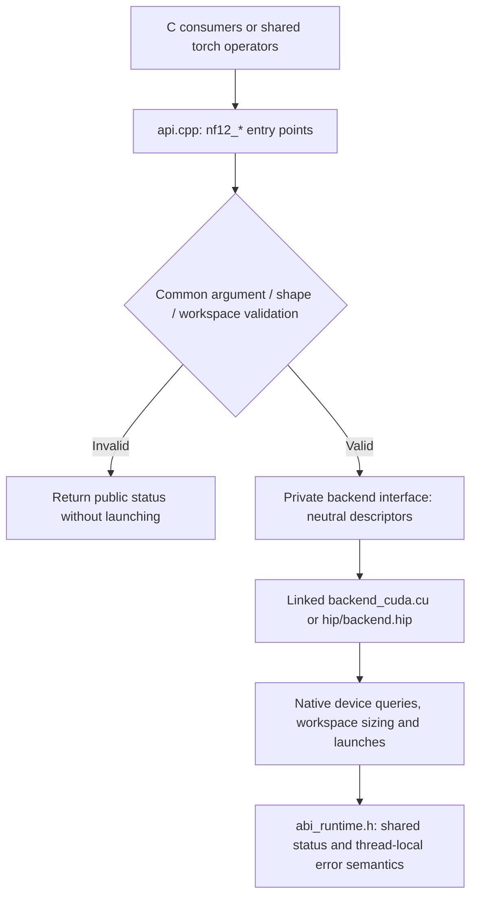

# Shared C ABI and native backends

CUDA and HIP compile the same `csrc/api.cpp` and `csrc/status.cpp` into their
native libraries. `include/nf12/nf12.h` retains the public function signatures,
status values and descriptor layouts. `csrc/torch/ops.cpp` and the Python API
remain shared and unchanged.

The backend is selected at build/link time. There is no per-call vendor
inference, dispatch registry, additional device allocation or global lock.
The shared frontend uses plain pointers and integer metadata; adapters convert
them to native CUDA/HIP types. Backend-private argument structures are not part
of the exported C ABI and are not consumed by vLLM's NF12 integration.

Shape bounds, alignment, empty-input behavior, packed byte counts, workspace
validation and error precedence now have one implementation. Workspace **sizes**,
capability decisions, tile selection and launches remain backend-specific.
The HIP adapter retains full/tail workspace sizing and large-M chunking; the
CUDA adapter delegates to its existing native launch planners. Backend limits
return an unsupported status rather than narrowing an expert count unsafely.

Raw C callers still supply scratch storage. Torch callers still obtain local
scratch from the caching allocator. Streams pass through unchanged; an empty
routing call still zeros offsets on the supplied stream. No mutable workspace
is shared across calls. Native runtime error state is thread-local, persists
across successful calls, and is not overwritten by codec validation or device
capability rejection. Grouped expert counts above INT32_MAX are rejected as
invalid before either backend is called.

The native `nf12_hip.h` entry points remain available. The single-token fused
MoE C++ boundary also retains its existing interface and implementations.

## Compatibility checks

- The public `nf12.h`, Python layer and torch operators are unchanged.
- The C99 consumer invokes all public C functions on each backend.
- Export checks verify the shared C symbol set.
- `tests/api/test_abi_contract.py` checks C and ctypes descriptor sizes and
  offsets against fixed LP64 baselines, plus error categories and thread isolation.
- Existing suites cover exact BF16t outputs, packed bytes, padded strides,
  invalid/empty inputs, workspace bounds, streams, GIL=0 and graph replay.

The bridge shrinks from 975 to 866 lines across its implementation and private
headers. The backend-specific copies of public validation and entry points are
removed. The native HIP BF16t compatibility entry point also uses the shared
validation and chunk dispatcher, translating its status back to `hipError_t`.

Validation on the final shared frontend: **647 passed** on R9700 and **447
passed** on RTX 4090, using GIL=0 and two visible devices. There were 12/13
backend-dependent skips respectively, plus the known PR #7 case deselected
in both runs. All four new ABI contract tests ran on both backends.

## ABI overhead comparison

Baseline `d2b752b` versus shared frontend `9a5074e`, source-built for each
backend. Interleaved public C calls use preallocated buffers and warm weights:
30 warmups, 151 host samples, and 51 graph samples with 16 calls per replay.
Host-call time measures the ctypes call to return; completion time includes
stream synchronization; GPU time uses events around graph replay. Values are
median microseconds, shown as **before → after**. All compared outputs, encoded
bytes, metadata, workspace sizes and BF16t packing matched exactly.

### R9700 — ROCm 10.1 / HIP 7.16.26385

| K × N | Operation | M | Host call µs | Completion µs | GPU graph µs |
| --- | --- | ---: | ---: | ---: | ---: |
| 896 × 4864 | pack_bf16t | — | 2.394 → 2.443 | 35.102 → 35.202 | 12.597 → 12.657 |
| 896 × 4864 | linear | 1 | 3.034 → 3.045 | 31.446 → 31.446 | 8.082 → 8.105 |
| 896 × 4864 | linear | 16 | 3.085 → 3.114 | 33.629 → 33.639 | 9.877 → 9.865 |
| 896 × 4864 | linear | 128 | 3.124 → 3.135 | 45.297 → 45.236 | 20.392 → 20.495 |
| 896 × 4864 | linear | 512 | 3.986 → 3.996 | 89.941 → 89.891 | 64.786 → 64.929 |
| 4096 × 4096 | pack_bf16t | — | 2.403 → 2.413 | 67.559 → 67.017 | 36.762 → 36.834 |
| 4096 × 4096 | linear | 1 | 3.044 → 3.055 | 42.863 → 42.833 | 19.407 → 19.465 |
| 4096 × 4096 | linear | 16 | 3.866 → 3.896 | 46.288 → 46.308 | 22.540 → 22.557 |
| 4096 × 4096 | linear | 128 | 3.094 → 3.115 | 76.832 → 76.692 | 59.039 → 58.486 |
| 4096 × 4096 | linear | 512 | 4.086 → 4.076 | 250.637 → 245.779 | 232.763 → 232.733 |

### RTX 4090 — CUDA 13.0

| K × N | Operation | M | Host call µs | Completion µs | GPU graph µs |
| --- | --- | ---: | ---: | ---: | ---: |
| 896 × 4864 | pack_bf16t | — | 3.004 → 2.985 | 11.927 → 12.048 | 6.592 → 6.642 |
| 896 × 4864 | linear | 1 | 3.635 → 3.646 | 10.806 → 10.736 | 4.800 → 4.858 |
| 896 × 4864 | linear | 16 | 3.595 → 3.596 | 11.807 → 11.778 | 6.208 → 6.208 |
| 896 × 4864 | linear | 128 | 4.316 → 4.306 | 18.387 → 18.507 | 12.028 → 12.096 |
| 4096 × 4096 | pack_bf16t | — | 2.994 → 2.974 | 61.891 → 62.762 | 23.360 → 22.060 |
| 4096 × 4096 | linear | 1 | 5.307 → 5.328 | 15.904 → 15.923 | 9.600 → 9.660 |
| 4096 × 4096 | linear | 16 | 5.248 → 5.308 | 19.608 → 19.729 | 13.362 → 13.376 |
| 4096 × 4096 | linear | 128 | 6.600 → 6.619 | 45.217 → 44.966 | 32.384 → 32.448 |

The largest host-call increase was 0.060 µs; the largest completion-time
slowdown was 1.41%. These warm microbenchmarks do not establish
full-model throughput or performance on other architectures.
